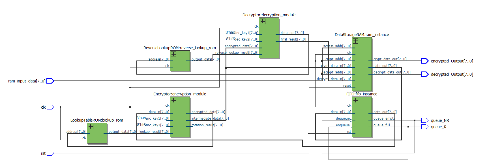
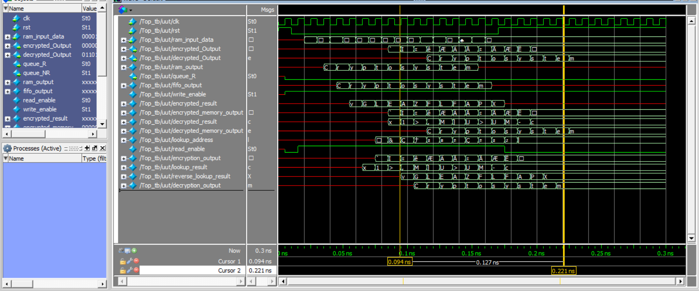
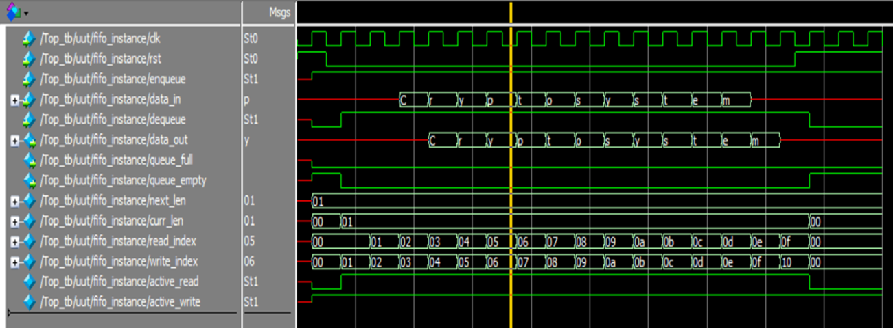

# RTL Cryptosystem Design in Verilog

**Modular, FPGA-oriented 8-bit encryption and decryption design using Verilog HDL, ASCII-encoded test data, XOR keys, lookup ROMs, bit rotation, and FIFO/RAM buffering.**

[](LICENSE)


**Author:** [Waleed Alakwa](https://github.com/WaleedAlakwa)  
**Copyright:** © 2026 Waleed Alakwa  
**License:** [MIT](LICENSE)  
**Project evidence:** Original RTL files, ASCII test data, hardware-architecture diagrams, finite-state diagram, and recorded simulation screenshots.



*Top-level datapath as captured in the original EDA environment.*

## Overview

This project explores a modular, reversible 8-bit data transformation in hardware description language. The RTL combines memory initialization, FIFO/SRAM buffering, substitution-style lookup modules, XOR-based key mixing, bit rotations, and a separate six-state controller. The supplied test demonstrates the processing of **`Cryptosystem`** as ASCII character bytes. The simulation screenshots supplied with the project illustrate intermediate data, FIFO activity, and the recovered text in the original development environment.

This is an **educational / experimental RTL cryptosystem**, not an audited secure encryption algorithm for protecting sensitive data.

## Main features

- Byte-wide data processing with ASCII-encoded sample plaintext.
- Encryption path with fixed demonstration keys (`8'h35`, `8'h6F`), lookup stage, rotation, and XOR.
- Decryption path that reverses the XOR/rotation sequence and uses a reverse lookup ROM.
- FIFO backed by a small SRAM buffer, with queue status signals.
- RAM buffers for source data and encrypted/decrypted results.
- Standalone controller modeled as `INIT → LOAD → ENCRYPT → DECRYPT → OUTPUT → IDLE`.
- Original top-level testbench and captured system/FIFO waveform evidence.

## Processing architecture

```text
              ASCII input / RAM
                       |
                       v
                  FIFO buffer
                       |
                       v
                 XOR with key 1
                       |
                       v
                Lookup-table ROM
                       |
                       v
                 Right rotate 3
                       |
                       v
                 XOR with key 2  ---> encrypted data
                       |
                       v
                 XOR with key 2
                       |
                       v
                 Right rotate 5
                       |
                       v
               Reverse lookup ROM
                       |
                       v
                 XOR with key 1  ---> recovered data
```

The diagram summarizes the intended conceptual sequence. Actual signal paths, synchronous ROM timing and buffering are defined by the Verilog modules; see [Architecture](docs/ARCHITECTURE.md).

## RTL modules

| File | Function |
|---|---|
| [`Top.v`](rtl/Top.v) | Top-level integration of RAM, FIFO, forward/reverse ROMs and encryptor/decryptor |
| [`DataStorageRAM.v`](rtl/DataStorageRAM.v) | Input memory and encryption/decryption buffer arrays |
| [`FIFO.v`](rtl/FIFO.v) | Enqueue/dequeue controls, pointers and queue status |
| [`SRAM_Buffer.v`](rtl/SRAM_Buffer.v) | FIFO backing storage |
| [`Encryptor.v`](rtl/Encryptor.v) | XOR, ROM interaction and bit rotation |
| [`Decryptor.v`](rtl/Decryptor.v) | Inverse XOR/rotation path and reverse-ROM interaction |
| [`LookupTableROM.v`](rtl/LookupTableROM.v) | Clocked lookup module reading `lookup_data.hex` |
| [`ReverseLookupROM.v`](rtl/ReverseLookupROM.v) | Clocked reverse lookup module reading `reverse_lookup_data.hex` |
| [`system_fsm.v`](rtl/system_fsm.v) | Six-state control model (supplied standalone; not instantiated by `Top.v`) |
| [`clock_driver.v`](rtl/clock_driver.v) | Clock-divider utility (supplied standalone; not instantiated by `Top.v`) |
| [`Top_tb.v`](sim/Top_tb.v) | Original stimulus-generation and output-observation testbench |

## ASCII test message and memory files

The demonstration message is **`Cryptosystem`**, stored as ASCII byte values (`43 72 79 70 74 6F 73 79 73 74 65 6D` in hexadecimal). The sample data contains a leading `00` at memory address `00`, with the 12 message characters at addresses `01`–`0C`.

- [`lookup_data.hex`](mem/lookup_data.hex): the 13-entry, address-tagged sample ASCII message **as supplied**.
- [`main_message.hex`](mem/main_message.hex): an identical copy included because `DataStorageRAM.v` reads this filename. Its origin is recorded in [Data and provenance](docs/ASCII_AND_DATA.md).
- [`reverse_lookup_data.hex`](mem/reverse_lookup_data.hex): the supplied 256-record reverse mapping using 8-bit hexadecimal addresses and values.

**The 13-entry message file is not expected to contain all 256 ASCII/byte values merely because it contains a test message.** The separate reverse table is a different type of data. See [ASCII and memory files](docs/ASCII_AND_DATA.md).

## Simulation evidence



*Original waveform capture from the author's simulation session, showing the byte-oriented input, intermediate data paths, and decrypted output signals.*



*Original FIFO waveform, including enqueue/dequeue, queue status, and read/write indices.*

Further images: [FSM visualization](assets/screenshots/controller-fsm.png), [RTL architecture screenshot](assets/screenshots/system-rtl-block-diagram.png), and [top-level Verilog editor capture](assets/screenshots/top-module-code.png). A detailed evidence index is in [Screenshots](docs/SCREENSHOTS.md).

The screenshots document the **original author-provided simulation**, not a new independent simulation performed while preparing this GitHub archive. The original `Top_tb.v` does not provide a self-checking pass/fail report; see [Verification scope](docs/VERIFICATION.md).

## Repository layout

```text
RTL-Cryptosystem-Design-in-Verilog/
├── README.md
├── LICENSE
├── AUTHORS.md
├── CITATION.cff
├── THIRD_PARTY_NOTICES.md
├── rtl/                       # 10 original Verilog design modules
├── sim/                       # Original Top_tb.v
├── mem/                       # ASCII sample and reverse lookup data
├── assets/
│   ├── screenshots/           # True PNG files ready for GitHub
│   └── original-captures/     # Original uploaded WebP image bytes
├── docs/                      # Technical explanations and evidence
└── tools/                     # Portable package/data checks
```

## Running and exploring the project

The source includes an original top-level testbench, captured waveforms, and HEX initialization files. Use the steps in [Simulation and setup](docs/SIMULATION.md) to prepare a compatible simulator, compile the design, and account for working-directory-relative `$readmemh` paths.

You can run the standalone data/package checks with Python 3 (no external packages):

```bash
python tools/check_package.py
```

This checks the included message bytes, file inventory, and README image paths; it **does not** claim an RTL simulation passed. Source logic has been preserved exactly, apart from additive copyright/SPDX comment headers.

## Documentation

- [Architecture and signal flow](docs/ARCHITECTURE.md)
- [ASCII example and memory-file provenance](docs/ASCII_AND_DATA.md)
- [Simulation/setup instructions](docs/SIMULATION.md)
- [Original evidence and verification scope](docs/VERIFICATION.md)
- [Screenshot gallery and explanations](docs/SCREENSHOTS.md)
- [Source inventory and checksums](docs/SOURCE_INVENTORY.md)

## Authorship, license and attribution

**Developed by Waleed Alakwa** · [GitHub @WaleedAlakwa](https://github.com/WaleedAlakwa).  
Copyright © 2026 Waleed Alakwa.

The original software and documentation are provided under the [MIT License](LICENSE), subject to ownership of the relevant material. Redistribution of copies or substantial portions of MIT-covered software must retain the license and copyright notice. Scholarly users can use [CITATION.cff](CITATION.cff); see [AUTHORS.md](AUTHORS.md) and [third-party notices](THIRD_PARTY_NOTICES.md).
